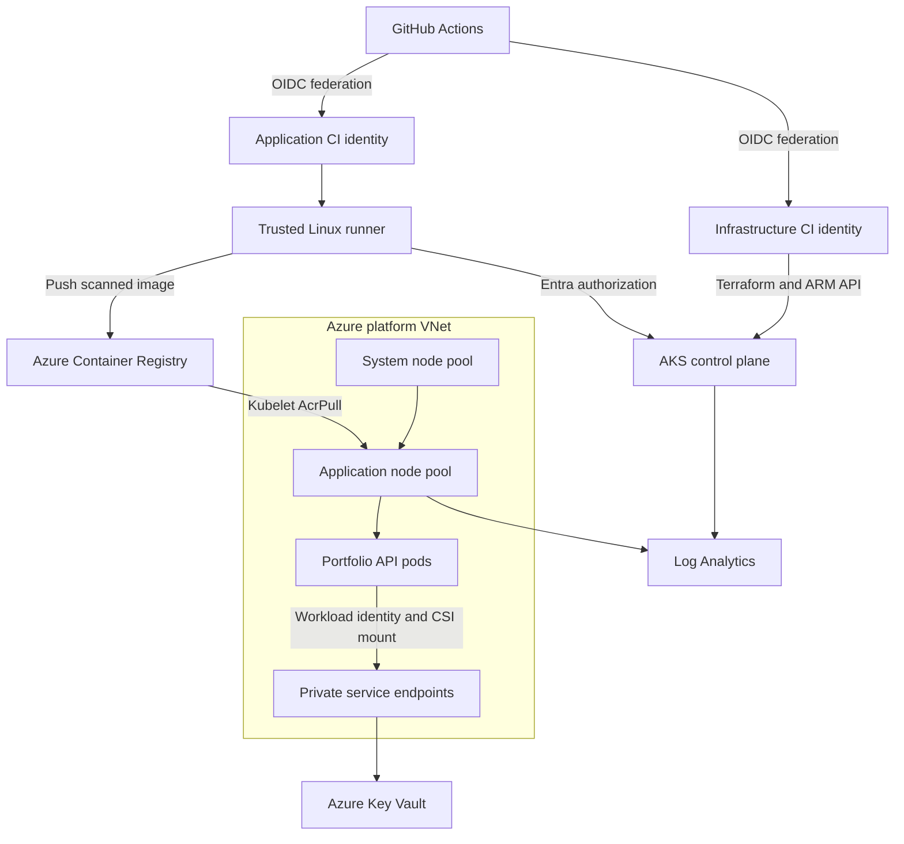

# Advanced Azure Kubernetes Service Platform

[](https://github.com/dotman01k/azure-client/actions/workflows/aks-validate.yml)

**Author: Dotun Agbeluyi | Azure Cloud and DevOps Engineer**

A practical AKS platform that brings together Terraform infrastructure, Azure identity federation, private service connectivity, Kubernetes security, automated image scanning and controlled application releases. The project is designed for hands on learning and for demonstrating engineering decisions during Azure and DevOps interviews.

**Validation status:** Terraform formatting and provider schema validation, API tests, Kubernetes overlay checks, Docker build and Trivy image scanning passed in [GitHub Actions](https://github.com/dotman01k/azure-client/actions/runs/39373255805). Azure provisioning and workload identity integration have not yet been exercised in a live subscription. Creating or updating repository files does not deploy infrastructure.

## Contents

1. [Problem and project goals](#problem-and-project-goals)
2. [Platform capabilities](#platform-capabilities)
3. [Architecture](#architecture)
4. [Development and production profiles](#development-and-production-profiles)
5. [Repository structure](#repository-structure)
6. [Prerequisites](#prerequisites)
7. [Deployment walkthrough](#deployment-walkthrough)
8. [Identity and permissions](#identity-and-permissions)
9. [Networking and application access](#networking-and-application-access)
10. [Application security and availability](#application-security-and-availability)
11. [Observability and operations](#observability-and-operations)
12. [Validation and troubleshooting](#validation-and-troubleshooting)
13. [Cost management and cleanup](#cost-management-and-cleanup)
14. [Portfolio walkthrough and limitations](#portfolio-walkthrough-and-limitations)

## Problem and project goals

Provisioning a Kubernetes cluster is only one part of delivering an application platform. A usable platform must also establish who can deploy, how images reach nodes, how applications retrieve secrets, how network traffic is limited, and how failed releases are detected.

This project implements those concerns as a connected workflow:

1. Provision Azure infrastructure from versioned Terraform configuration.
2. Authenticate automation using federated identity rather than stored Azure client secrets.
3. Separate infrastructure administration from routine application deployment.
4. Retrieve a demonstration secret from private Key Vault through an AKS service account identity.
5. Scan and publish a container image, then deploy its exact digest.
6. Enforce workload security settings, health checks, scaling rules and disruption controls.
7. Record operational guidance and explain the tradeoffs honestly.

## Platform capabilities

| Capability | What this project implements | Why it matters |
| --- | --- | --- |
| Infrastructure as code | Terraform 1.13.0 and AzureRM 4.52.0, dependency lock file, reusable network module | Repeatable infrastructure changes and reviewable configuration |
| Cluster identity | User assigned control plane identity and Entra RBAC | Azure permissions can be managed without local cluster administrator credentials |
| Workload separation | Dedicated system pool and tainted application pool | Application scheduling is separated from critical system add-ons |
| Networking | Azure CNI Overlay with Cilium, subnet separation and NAT Gateway | Predictable outbound IP and Kubernetes network policy enforcement |
| Production connectivity | Private API and private registry endpoint | Production administration and image delivery require private network access |
| Secrets | Private Key Vault, Secrets Store CSI provider and workload federation | Pods can receive mounted secrets without client secrets in source code |
| Delivery | GitHub OIDC, Terraform plan/apply jobs, application release workflow | Infrastructure and application changes follow explicit execution paths |
| Container security | Trivy scan before push and immutable deployment digest | Releases are tied to a specific image that passed the configured scan policy |
| Workload availability | HPA, PDB, rolling update, topology spread and probes | Capacity, voluntary disruption and release health are addressed separately |
| Monitoring | Container Insights, selected control plane logs and CPU email alert | Operators have a starting point for investigation and response |

## Architecture

The connected runner is the deployment bridge into the platform network. Infrastructure jobs use Azure's management API; application jobs also require access to the private services and Kubernetes API.



The diagram describes logical responsibilities. System nodes do not forward application traffic to the application pool. Production ACR and Key Vault use private endpoints; dev ACR is public with RBAC authentication. See the [architecture decisions](docs/architecture.md) for boundaries and tradeoffs.

## Development and production profiles

| Setting | Dev example | Prod example |
| --- | --- | --- |
| AKS management tier | Free | Standard |
| API endpoint | Public with explicit authorized CIDRs | Private |
| System node pool | Minimum 1, maximum 2 | Minimum 3, maximum 6 |
| Application node pool | Minimum 1, maximum 3 | Minimum 3, maximum 10 |
| Node size | Standard_D2s_v5 | Standard_D2s_v5 |
| Availability zones | No explicit zone distribution | Zones 1, 2 and 3 |
| Application HPA | 2 to 6 pods | 3 to 10 pods |
| Registry | Basic, public endpoint, admin disabled | Premium with private endpoint, public access disabled |
| Key Vault | Private endpoint, public access disabled | Private endpoint, public access disabled |
| Log retention and daily cap | 30 days, 1 GB cap | 30 days, 5 GB cap |
| Application service | ClusterIP | ClusterIP |

These are examples to review before deployment. Region capacity, VM quota and supported Kubernetes versions must be checked in the target subscription. Production configuration rejects a public API or fewer than three minimum nodes in either pool. Dev's two or more application replicas can still share a single node and therefore do not guarantee host redundancy.

## Repository structure

Paths below are relative to this project directory.

| Path | Responsibility |
| --- | --- |
| [infra/main.tf](infra/main.tf) | AKS, control plane identity, network module and application node pool |
| [infra/services.tf](infra/services.tf) | Registry, Key Vault, private service connectivity, federation and RBAC |
| [infra/observability.tf](infra/observability.tf) | Log Analytics, diagnostic settings, CPU alert and action group |
| [infra/variables.tf](infra/variables.tf) | Deployment inputs and validation rules |
| [infra/outputs.tf](infra/outputs.tf) | Cluster, registry, identity and networking outputs |
| [infra/modules/network](infra/modules/network) | VNet, node, private endpoint and runner subnets, NAT egress |
| [infra/environments](infra/environments) | Dev and prod tfvars examples |
| [app](app) | Dependency free Python HTTP API and container build definition |
| [k8s/platform](k8s/platform) | Namespace, resource quotas, network policy, service account and CSI template |
| [k8s/app](k8s/app) | Application base resources and environment Kustomize overlays |
| [scripts](scripts) | Azure bootstrap, Terraform initialization, cluster login and release helpers |
| [tests](tests) | HTTP API behavior tests and rendered manifest checks |
| [docs](docs) | Setup, architecture, runbook, validation evidence and interview walkthrough |
| [GitHub workflows](../.github/workflows) | Validation, infrastructure, platform initialization and application release |

## Prerequisites

| Requirement | Purpose |
| --- | --- |
| Azure commercial subscription | Hosts the platform resources |
| Appropriate bootstrap permissions | Registers providers, creates identities and assigns Azure roles |
| Entra administrator group | Provides named human recovery and administration access |
| Regional vCPU quota and capacity | Supports minimum nodes, autoscaling and upgrade surge |
| Terraform 1.13.x | Matches the repository's supported CLI version |
| Azure CLI | Performs authentication, bootstrap and cluster credential retrieval |
| Python 3.12 and PyYAML | Runs API tests and manifest rendering helpers |
| Docker | Builds and pushes the sample image |
| GitHub Actions | Executes validation and manually triggered deployment workflows |
| Connected Linux runner | Reaches private AKS, Key Vault and production ACR |

The project creates a runner subnet. It does not provision a runner VM or register a GitHub runner. The [setup guide](docs/setup.md) lists the runner software and connectivity requirements.

## Deployment walkthrough

### 1. Clone the project and inspect configuration

```bash
git clone https://github.com/dotman01k/azure-client.git
cd azure-client/advanced-aks
```

Review [dev.tfvars.example](infra/environments/dev.tfvars.example), [prod.tfvars.example](infra/environments/prod.tfvars.example), the network ranges, quota and [setup guide](docs/setup.md). Replace all example identifiers before using them.

### 2. Create the backend and CI identities

The initial bootstrap is operator authenticated. It creates the platform resource group, remote state storage and distinct infrastructure/application CI identities. It also configures federated credentials for the selected GitHub environment subjects.

```bash
az login
export SUBSCRIPTION_ID='<your-subscription-id>'
export DEPLOY_ENV=dev
export STATE_ACCOUNT='<globally-unique-storage-account>'
export GITHUB_REPOSITORY=dotman01k/azure-client
export LOCATION=eastus
bash scripts/bootstrap.sh
```

Use the reported **client IDs** for GitHub login configuration and the reported **principal IDs** for Terraform role assignment inputs. The state container is authenticated with Entra and has shared key access disabled. Bootstrap resources live outside the Terraform state and are intentionally retained by Terraform destroy.

### 3. Configure environments and variables

Create `dev-plan`, `dev`, and `dev-app`; repeat with `prod` when ready. Restrict their deployment branches to `main` and configure required reviewers where supported. Environment review protection must be configured in GitHub; defining an environment name in YAML does not create an approval gate by itself.

| Variable | Purpose |
| --- | --- |
| `AZURE_SUBSCRIPTION_ID`, `AZURE_TENANT_ID` | Target Azure account context |
| `INFRA_CLIENT_ID` | Federated infrastructure login |
| `APP_CLIENT_ID` | Federated application login |
| `STATE_RESOURCE_GROUP`, `STATE_STORAGE_ACCOUNT` | Terraform remote backend |
| `TFVARS_JSON` | JSON object containing reviewed environment configuration |
| `AZURE_RESOURCE_GROUP`, `AKS_CLUSTER_NAME` | Existing platform targets after Terraform apply |
| `KEY_VAULT_NAME`, `WORKLOAD_CLIENT_ID` | CSI integration configuration |
| `ACR_NAME` | Container registry target |

The exact environment placement and a complete JSON example appear in [setup](docs/setup.md#2-configure-github-environments). The plan and apply environments must refer to the same subscription, configuration and state key.

### 4. Provision the Azure infrastructure

| Workflow | Trigger and runner | Result |
| --- | --- | --- |
| AKS Validate | Push, pull request or manual; GitHub hosted runner | Checks formatting, provider schema, tests, manifests, build and scan |
| AKS Infrastructure | Manual; GitHub hosted runner | Plans infrastructure, optionally applies that run's saved plan |
| AKS Initialize Platform | Manual; trusted connected runner | Seeds a harmless demo secret and creates platform Kubernetes resources |
| AKS Release Application | Manual; trusted connected runner | Builds, scans, pushes and deploys an immutable image digest |

Start **AKS Infrastructure** with `operation=plan`. Inspect the proposed resource changes. When ready, run `operation=apply` and review that run's `plan.txt` artifact before approving its apply job. Apply consumes the saved plan from the same workflow run, rather than generating an unrelated replacement plan.

Copy the output values from the workflow artifact into the appropriate GitHub environment variables. Plan artifacts are kept for one day and outputs for seven days. Do not place actual application secrets in Terraform inputs or workflow artifacts.

### 5. Connect the runner and initialize Kubernetes

Register a trusted Linux runner with `self-hosted`, `linux`, and `aks` labels. It must resolve and reach the platform's private endpoints. For the dev public API, allow its actual outbound CIDR, including the generated NAT IP when the runner uses the platform subnet.

Run **AKS Initialize Platform** once infrastructure and role assignments are ready. It creates namespace `portfolio`, restricted pod security labels, quotas, network policies, the `portfolio-api` service account and the Key Vault SecretProviderClass. It seeds a non-sensitive demonstration secret named `demo-message`.

### 6. Release and verify the application

Run **AKS Release Application**. It scans fixable HIGH and CRITICAL image findings before pushing, resolves the ACR digest, deploys that digest and waits up to five minutes for rollout health.

From an authorized session with network connectivity, authenticate and test:

```bash
export AZURE_RESOURCE_GROUP=rg-aks-dev
export AKS_CLUSTER_NAME=dotunaks-dev-aks
source scripts/cluster-login.sh
kubectl -n portfolio get deployment,pods,service,hpa,pdb
kubectl -n portfolio rollout status deployment/portfolio-api --timeout=300s
kubectl -n portfolio port-forward service/portfolio-api 8080:80
```

In a second terminal, `curl http://127.0.0.1:8080/` should return JSON describing `portfolio-api`, its environment and whether the secret file is mounted. No secret value is returned.

| Endpoint | Behavior |
| --- | --- |
| `/` | Service metadata and `secret_mounted` status |
| `/healthz` | Process liveness |
| `/readyz` | HTTP 200 when the mounted secret file exists, otherwise 503 |
| `/metrics` | Prometheus text exposing a request counter |

## Identity and permissions

| Identity | Scope and permissions | Responsibility |
| --- | --- | --- |
| Infrastructure CI | Contributor and User Access Administrator on platform RG; Blob Data Contributor on state; AKS Cluster Admin for platform setup | Provision and initialize the platform |
| Application CI | AcrPush on its registry; AKS Cluster User; namespace scoped AKS RBAC Writer | Build and release the application |
| AKS control plane | Network Contributor on platform VNet | Manage cluster networking |
| AKS kubelet | AcrPull on the registry | Pull images onto nodes |
| Application workload | Key Vault Secrets User on its vault | Retrieve CSI mounted secret content |
| Entra administrator group | Configured cluster administrator group | Human administration and recovery |

GitHub OIDC and AKS workload identity are two distinct trust relationships. GitHub federation trusts environment subjects from `token.actions.githubusercontent.com`; workload federation trusts the AKS issuer and `system:serviceaccount:portfolio:portfolio-api` subject. Neither requires a stored application client secret.

Infrastructure CI deliberately has powerful permissions. Routine application deployment uses the separate identity, and its namespace Writer role is broader than a custom Deployment-only permission set. See [security decisions](docs/architecture.md#security-and-delivery-tradeoffs).

## Networking and application access

| Network | CIDR | Purpose |
| --- | --- | --- |
| VNet | `10.20.0.0/16` | Platform network |
| Nodes | `10.20.0.0/22` | AKS node interfaces |
| Private endpoints | `10.20.4.0/24` | Key Vault and production ACR connectivity |
| Runners | `10.20.5.0/24` | Connected deployment runner placement |
| Overlay pods | `10.244.0.0/16` | Pod address allocation |
| Kubernetes services | `10.240.0.0/16` | Service virtual IPs |

Dev and prod examples reuse the same address ranges in isolated VNets. They must be changed to non-overlapping ranges before peering those networks.

The portfolio namespace denies ingress and egress by default. An application rule permits DNS, ingress from same-namespace pods labeled `access=portfolio-api`, and outbound TCP 443. The HTTPS rule permits any destination on that port; it is not an FQDN allowlist. System CSI component traffic is outside the complete scope of application pod policy.

No public ingress controller, public DNS record or TLS endpoint is created. Use authenticated port forwarding for the lab. Add an ingress and certificate design through a separate reviewed change if internet access is required.

## Application security and availability

| Control | Implementation |
| --- | --- |
| Runtime identity | UID/GID 10001 with runAsNonRoot |
| Filesystem | Read only root with a small dedicated temporary volume |
| Privileges | Privilege escalation disabled, all Linux capabilities dropped, RuntimeDefault seccomp |
| Pod admission | Restricted Pod Security labels on namespace |
| Secret handling | CSI volume, automatic rotation enabled, no Kubernetes Secret sync and no response disclosure |
| Resource governance | CPU/memory requests and limits, namespace quota and LimitRange |
| Release strategy | RollingUpdate with zero maxUnavailable and one surge pod |
| Scaling | CPU target 65 percent, HPA scale down stabilization and autoscaled node pools |
| Voluntary disruption | PDB maxUnavailable 1 |
| Placement | Dedicated application pool, hostname spread and production zone spread |

The release helper strips Deployment replicas before applying so the HPA owns that field. Availability controls address different failure modes; a PDB is not a backup or a guarantee against involuntary outages.

## Observability and operations

Container Insights collects workload telemetry. Selected control plane diagnostic categories and platform metrics are sent to Log Analytics. An Azure Monitor alert sends email when average node CPU exceeds 85 percent for 15 minutes.

The application exposes `/metrics`, but managed Prometheus, Grafana and custom application scraping are not provisioned. The [operations runbook](docs/operations.md) includes KQL examples, identity checks, image pull troubleshooting, scaling drills and rollback.

For a failed release, inspect events and logs before deciding to roll back:

```bash
kubectl -n portfolio get events --sort-by=.lastTimestamp
kubectl -n portfolio logs deployment/portfolio-api --tail=100
kubectl -n portfolio rollout history deployment/portfolio-api
kubectl -n portfolio rollout undo deployment/portfolio-api
kubectl -n portfolio rollout status deployment/portfolio-api --timeout=300s
```

The workflow reports rollout failure and does not automatically roll back. A repeatable rollback uses the release script with a previous known-good digest retained in ACR.

## Validation and troubleshooting

Run from this project directory:

```bash
terraform -chdir=infra fmt -check -recursive
terraform -chdir=infra init -backend=false -lockfile=readonly
terraform -chdir=infra validate
python -m pip install PyYAML==6.0.2
python -m unittest discover -s tests -v
kubectl kustomize k8s/app/overlays/dev > /tmp/dev.yaml
kubectl kustomize k8s/app/overlays/prod > /tmp/prod.yaml
python tests/check_manifests.py /tmp/dev.yaml /tmp/prod.yaml
for script in scripts/*.sh; do bash -n "$script"; done
```

| Symptom | First checks |
| --- | --- |
| OIDC login fails | Exact repository/environment subject, tenant, client ID and environment name |
| State storage returns 403 | Blob Data Contributor scope, Entra authentication and role propagation |
| Terraform fails on quota | VM family quota, regional capacity and surge headroom |
| Cluster authentication fails | Cluster User role plus Kubernetes authorization role; Entra login via kubelogin |
| Private endpoint unreachable | Runner routing, private DNS links and endpoint approval |
| CSI volume will not mount | Secret exists, client ID annotation, workload label, federation subject and vault role |
| ImagePullBackOff | Registry digest exists, kubelet AcrPull role and registry connectivity |
| HPA does not scale | Metrics availability, CPU requests, load, quotas and node pool capacity |
| Workflow waits for runner | Registered runner has all three required labels and is online |
| Apply does not pause for approval | Required reviewers were not configured or are unavailable for the repository plan |

[Validation evidence](docs/validation.md) distinguishes checks already executed from Azure integration tests that still need to run.

## Cost management and cleanup

Dev has a minimum of two D2s_v5 nodes; production has a minimum of six. Additional charges can include managed disks, NAT Gateway, public IP, private endpoints, registry storage and tier, log ingestion and the connected runner. Autoscaling and upgrade surge require additional headroom.

Use Azure Pricing Calculator for a current estimate before deployment. Log ingestion caps reduce ingestion but do not guarantee a total spending ceiling. Stopping AKS does not eliminate every supporting resource charge.

There is deliberately no destroy workflow. For a disposable lab, review the correct subscription, backend key and `terraform plan -destroy` before deleting anything. Follow [cleanup guidance](docs/operations.md#cleanup). Terraform destroy retains bootstrap resource groups, identities and state storage. Key Vault purge protection and retention can prevent immediate name reuse.

## Portfolio walkthrough and limitations

This project demonstrates practical decisions about Terraform state, CI federation, workload identity, private DNS, RBAC, autoscaling, release health and operational boundaries. Use the [interview walkthrough](docs/interview-walkthrough.md) to explain the design and its tradeoffs.

The production example still needs target-subscription deployment tests, security review and organization-specific decisions before production use. It does not configure business data backups, disaster recovery, Azure Firewall, Defender plans, managed Prometheus, ingress/TLS, SLOs or maintenance windows. The Azure Policy add-on is enabled, but organizational policy assignments are not included.

Future projects will use their own dedicated repositories. CI federation subjects, workflow paths and documentation links must match the repository where this project is ultimately hosted.

## Further documentation

1. [Complete setup guide](docs/setup.md)
2. [Architecture decisions](docs/architecture.md)
3. [Operations and rollback runbook](docs/operations.md)
4. [Validation evidence](docs/validation.md)
5. [Interview walkthrough](docs/interview-walkthrough.md)
6. [Azure CNI powered by Cilium](https://learn.microsoft.com/azure/aks/azure-cni-powered-by-cilium)
7. [Microsoft Entra Workload ID](https://learn.microsoft.com/azure/aks/workload-identity-overview)
8. [Key Vault CSI identity access](https://learn.microsoft.com/azure/aks/csi-secrets-store-identity-access)
9. [Pinned AzureRM AKS resource documentation](https://registry.terraform.io/providers/hashicorp/azurerm/4.52.0/docs/resources/kubernetes_cluster)
