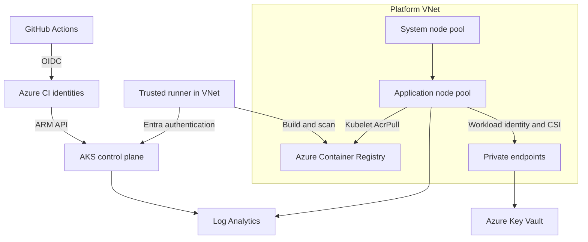

# Advanced AKS deployment platform

An Azure portfolio and practical deployment project by Dotun Agbeluyi. It demonstrates how to provision and operate AKS with infrastructure as code, separate infrastructure and application identities, controlled releases, and Kubernetes security controls.

**Status:** Source implementation with local validation. Azure deployment, private DNS connectivity, quota availability, and end-to-end rollout must be verified in your own subscription. Pushing this repository does not deploy Azure resources.

## What is included

| Area | Implementation |
| --- | --- |
| Infrastructure | Terraform 1.13.0, AzureRM 4.52.0, dependency lock file, reusable network module |
| AKS | Separate autoscaling system and tainted application pools; Entra RBAC; local admin disabled |
| Networking | Azure CNI Overlay and Cilium, dedicated node/private endpoint/runner subnets, explicit NAT egress |
| Production profile | Private API, three availability zones, minimum three nodes in each pool, Premium ACR private endpoint |
| Application identity | OIDC federation from one Kubernetes service account to an Azure managed identity |
| Secrets | Private Key Vault, CSI mount and rotation, RBAC; no secret values in Terraform state |
| Supply chain | Container vulnerability scan before push, SHA-tagged builds, digest-based deployments, Dependabot |
| Application | Non-root Python API, read-only filesystem, dropped capabilities, restricted pod security |
| Availability | Probes, HPA, disruption budget, topology spread, resource quotas, rollout timeout |
| Observability | Container Insights, control plane diagnostic logs, CPU metric alert, sample KQL, application `/metrics` |
| Delivery | Credential-free PR validation, manual Terraform plan/apply, protected environment support, namespace-scoped application deployment |

## Architecture



The application uses a ClusterIP service. Access is intentionally through authenticated port forwarding or a same-namespace authorized client. An internet ingress, public DNS name and TLS termination are outside this project's baseline. See [architecture and design decisions](docs/architecture.md).

## Deployment sequence

1. Follow [setup](docs/setup.md) to create state storage and two CI identities for each environment. This requires your Azure account and explicit execution; nothing here has been deployed on your behalf.
2. Create GitHub environments and variables. Review the dev/prod examples before configuring `TFVARS_JSON`.
3. Run **AKS Infrastructure** with `operation=plan`. Review the plan. For deployment, run it with `operation=apply`; the apply job uses that run's saved plan after your configured environment approval.
4. Register a trusted Linux runner with labels `self-hosted`, `linux`, `aks` and VNet connectivity. The project creates a runner subnet but does not create or register a runner machine.
5. Run **AKS Initialize Platform**, then **AKS Release Application**.
6. Follow [operations](docs/operations.md) to test identity, inspect rollout health and exercise scaling or rollback.

## Repository layout

| Path | Purpose |
| --- | --- |
| `infra/` | Infrastructure, RBAC, private endpoints and environment examples |
| `infra/modules/network/` | Network and explicit egress module |
| `k8s/platform/` | Administrator-owned namespace, network policy and identity configuration |
| `k8s/app/` | Application deployment, HPA, PDB and dev/prod Kustomize overlays |
| `app/` | Dependency-free sample API and Dockerfile |
| `scripts/` | Bootstrap, Terraform initialization, Entra cluster login and release scripts |
| `tests/` | API behavior and rendered-manifest checks |
| `docs/` | Setup, architecture, operations and interview walkthrough |
| `../.github/workflows/` | Validation and manual deployment workflows |

## Local validation

```bash
cd advanced-aks/infra
terraform fmt -check -recursive
terraform init -backend=false -lockfile=readonly
terraform validate
cd ..
python -m pip install PyYAML==6.0.2
python -m unittest discover -s tests -v
kubectl kustomize k8s/app/overlays/dev > /tmp/dev.yaml
kubectl kustomize k8s/app/overlays/prod > /tmp/prod.yaml
python tests/check_manifests.py /tmp/dev.yaml /tmp/prod.yaml
for script in scripts/*.sh; do bash -n "$script"; done
```

Validation does not need Azure credentials. Container build and scanning run in **AKS Validate** on GitHub. Review [validation evidence](docs/validation.md) for checks actually executed during creation.

## Cost and operational boundaries

Dev starts with two D2s_v5 nodes total; production starts with six, plus NAT Gateway, disks, log ingestion, private endpoints and registry charges. Autoscaling can increase compute costs. Stopping AKS does not stop every supporting resource from billing. Get a current estimate in Azure Pricing Calculator and confirm regional vCPU quota before applying.

`prod` is a production-oriented example, not a claim of audited production readiness. It does not configure backups, Azure Firewall, Defender plans, managed Prometheus, Grafana, ingress, an SLO or disaster recovery. Purge protection means the deleted Key Vault name remains reserved during retention. Bootstrap storage, identities and resource groups are intentionally outside Terraform destroy.

## References

* [Azure CNI powered by Cilium](https://learn.microsoft.com/azure/aks/azure-cni-powered-by-cilium)
* [Microsoft Entra Workload ID](https://learn.microsoft.com/azure/aks/workload-identity-overview)
* [Key Vault CSI identity access](https://learn.microsoft.com/azure/aks/csi-secrets-store-identity-access)
* [Azure RBAC for Kubernetes authorization](https://learn.microsoft.com/azure/aks/manage-azure-rbac)
* [AzureRM AKS resource, pinned provider version](https://registry.terraform.io/providers/hashicorp/azurerm/4.52.0/docs/resources/kubernetes_cluster)
* [GitHub OIDC with Azure](https://docs.github.com/actions/how-tos/security-for-github-actions/security-hardening-your-deployments/configuring-openid-connect-in-azure)
